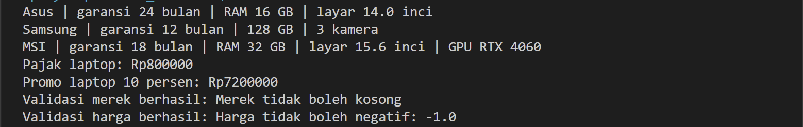
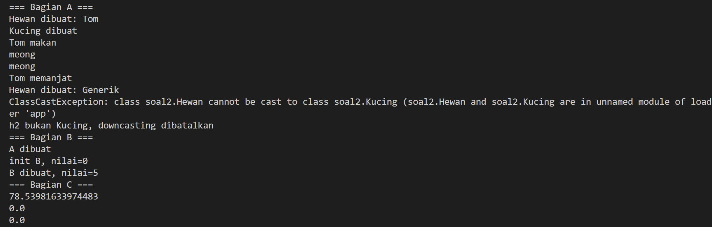
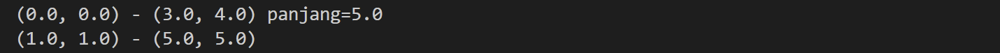
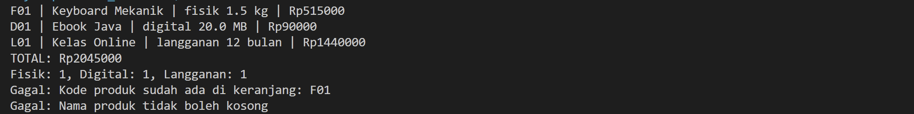

# Tugas 2 Praktikum PBO: Inheritance, Composition, dan Polimorfisme

- **Nama:** Farisha Tara Ushna Dinatama
- **NPM:** 250810701100105
- **Kelas:** A Praktikum PBO
- **Repository:** https://github.com/farishatara/Tugas2_Inherit-polymorph-25105

## Deskripsi Singkat
Program Java untuk menyelesaikan 4 soal latihan OOP (*Inheritance, Composition, Polimorfisme*). Kode menggunakan Javadoc, konstanta tarif, dan validasi data (*Exception*).

## Fitur Utama
* **Soal 1:** Hitung pajak/promo perangkat elektronik dan validasi input.
* **Soal 2:** Simulasi urutan constructor, casting aman, dan relasi objek.
* **Soal 3:** Buat garis dari titik koordinat dengan fitur *defensive copy*.
* **Soal 4:** Aplikasi keranjang belanja toko digital (produk fisik, digital, langganan).

## Konsep OOP yang Dipakai

| Konsep | Lokasi | Alasan |
|---|---|---|
| **Inheritance** | `Laptop`, `Ponsel` extends `Perangkat` | Mengelompokkan sifat umum ke superclass. |
| **`protected`** | `Perangkat.harga` | Subclass bisa akses langsung atribut induk. |
| **`super`** | Constructor & `super.infoSingkat()` | Jalankan constructor induk tanpa duplikasi kode. |
| **Overriding** | `infoSingkat()`, `hitungHargaAkhir()` | Memberi perilaku spesifik pada subclass. |
| **Overloading** | Dua constructor `Garis` | Menyediakan beberapa cara buat objek baru. |
| **Composition** | `Garis`(Titik), `Keranjang`(Produk) | Hubungan kepemilikan objek (*has-a*). |
| **Polimorfisme**| `hitungTotal()`, `cetakStruk()` | Eksekusi method dinamis sesuai tipe asli saat runtime. |
| **`instanceof`** | `hitungPerJenis()`, `TesSoal2` | Cek tipe objek sebelum casting agar tidak error. |
| **Defensive copy**| Constructor `Garis` | Gandakan objek input agar data internal aman dari luar. |
| **Exception** | `IllegalArgumentException` | Validasi input data salah (merek kosong/harga minus). |

## Struktur Project
```text
Tugas2_Inherit-polymorph-25105/
├── src/
│   ├── soal1/ (Perangkat, Laptop, Ponsel, LaptopGaming, TesSoal1)
│   ├── soal2/ (Hewan, Kucing, A, B, Lingkaran, Titik, TesSoal2)
│   ├── soal3/ (Titik, Garis, TesSoal3)
│   └── soal4/ (Produk, ProdukFisik, ProdukDigital, Langganan, Keranjang, TesSoal4)
└── README.md
```

## Cara Menjalankan
* **IDE:** Buka project di IntelliJ \(\rightarrow\) Klik kanan `src` \(\rightarrow\) *Mark Directory as > Sources Root* \(\rightarrow\) Run kelas `TesSoal1` s.d `TesSoal4`.
* **Terminal:**
  ```bash
  javac -d out $(find src -name "*.java")
  java -cp out soal1.TesSoal1
  ```
  *(PowerShell Windows: `javac -d out (Get-ChildItem -Recurse src -Filter *.java).FullName`)*

##  Contoh Output
- 
- 
- 
- 

## Jawaban Soal dan Analisis

### Soal 1
* **Error:** `harga has private access in Perangkat`.
* **Analisis:** Variabel `private` tidak bisa diakses langsung oleh subclass (`Laptop`). Solusinya ubah kembali ke `protected` atau gunakan fungsi getter.

### Soal 2
* **Bagian A:** Output lengkap program sampai crash:
  ```text
  Hewan dibuat: Tom
  Tom makan
  meong
  meong
  Tom memanjat
  Hewan dibuat: Generik
  Exception in thread "main" java.lang.ClassCastException: class Hewan cannot be cast to class Kucing
  ```
  * Menghapus `h.panjat()` bikin **error kompilasi** karena tipe statis `Hewan` tidak punya fungsi `panjat()`.
  * `ClassCastException` terjadi karena objek `Hewan` asli dipaksa jadi `Kucing`. Solusinya pakai cek `instanceof`.
  * `h.makan()` memanggil `suara()` milik `Kucing` karena program memilih method berdasarkan tipe dinamis objek saat runtime.

* **Bagian B:** Output `new B()` adalah `A dibuat` $\rightarrow$ `init B, nilai=0` $\rightarrow$ `B dibuat, nilai=5`. Nilai tercetak `0` karena constructor induk dijalankan sebelum field anak diinisialisasi. Risikonya, objek anak bisa membaca data kosong/null yang belum siap.

* **Bagian C:** `l3.luas()` bernilai `0.0` karena mengikuti objek aslinya (`Titik`). Relasi "Titik adalah Lingkaran" salah secara konsep (*Liskov Substitution Principle*). Jika fungsi lain wajib mengharuskan luas > 0, program bisa salah hitung atau error bagi nol.

### Soal 3
1. **Sebelum perbaikan:** `(100.0, 1.0) - (5.0, 5.0)` karena masalah *aliasing* (berbagi referensi memori yang sama).
2. **Setelah perbaikan:** `(1.0, 1.0) - (5.0, 5.0)` berkat *defensive copy*.
3. **Analisis:** Berbagi referensi cocok untuk objek interaktif (misal titik grafik digeser kursor). *Defensive copy* tepat untuk menjaga data internal mandiri dan aman dari efek samping luar.
4. **Masalah Desain:** `Garis extends Titik` melanggar relasi *is-a* karena garis bukan sebuah titik. Hubungan yang benar adalah *has-a* (Composition).

### Analisis Konsep Utama
1. **Overriding vs Overloading:** *Overriding* menimpa method induk dengan nama & parameter sama (polimorfisme runtime). *Overloading* membuat method bernama sama dengan parameter beda (ditentukan saat kompilasi).
2. **Inheritance vs Composition:** *Inheritance* untuk hubungan "adalah/is-a" (`ProdukFisik` adalah `Produk`). *Composition* untuk hubungan "punya/has-a" (`Keranjang` punya `Produk`). Composition jauh lebih fleksibel.
3. **Polimorfisme di Soal 4:** `cetakStruk()` pakai polimorfisme karena semua produk dipanggil seragam lewat method `hitungHargaAkhir()`. `hitungPerJenis()` butuh `instanceof` untuk menyaring tipe spesifik objek demi menghitung jumlahnya. Downcasting tidak selalu aman dan memicu `ClassCastException` jika tipe aslinya salah.

## Batasan Sistem
* Fitur bonus `ProdukBundel` belum dibuat.
* Keranjang belanja belum bisa menghapus barang atau mengubah jumlahnya.
* Pengujian unit masih manual lewat kelas `main` (belum pakai JUnit).

